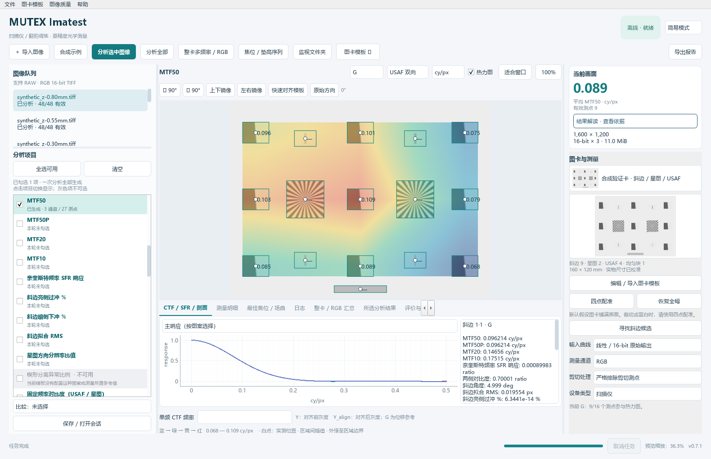
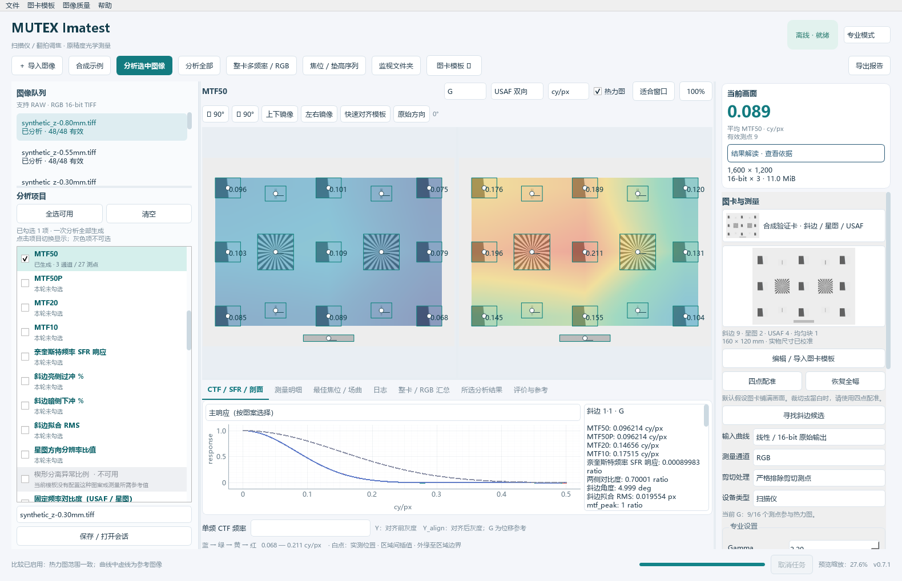
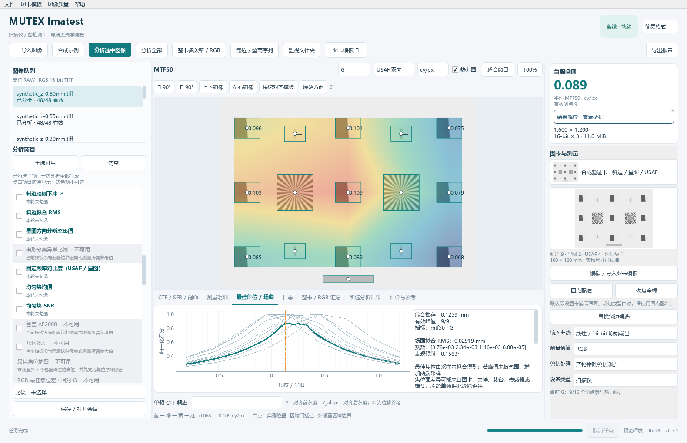

# MUTEX Imatest

**面向扫描仪与相机翻拍的离线调焦、光学测量与图像质量分析工具。**

[](https://github.com/RayforLoy/MUTEX-Imatest/releases/latest) [](https://github.com/RayforLoy/MUTEX-Imatest/releases/latest) [](pyproject.toml) [](LICENSE)

[下载与运行](#下载与运行) · [快速开始](#快速开始) · [功能概览](#功能概览) · [图卡模板](#图卡模板) · [开发与构建](#开发与构建) · [文档](#文档)

从一张测试卡观察全幅清晰度、方向差异和 RGB 彩边，再用焦位序列寻找更合适的调焦位置。支持 USAF 1951、西门子星图、ISO 12233 风格图卡、斜边及棋盘格，提供多位置热力图、频率响应曲线、通道对齐比较和可保存的测量报告。

- **原始精度测量**：大幅面 TIFF 分块读取，测量直接使用原生像素；预览缩略图与显示瓦片不参与计算。
- **一次分析多个项目**：左侧勾选所需指标，共享测量过程；简易 / 专业模式使用同一引擎，GUI 与 CLI 共用分析逻辑。
- **结果有依据**：保留有效覆盖率、质量标志、标定信息和评价参考，避免把缺失测量当作零值或通过。
- **本机离线处理**：桌面分析不需要账号、联网或上传 RAW / TIFF，源图保持不变。



*v0.7.1 实际软件界面。本文截图均来自随附的合成验证卡，不代表任何设备实测性能。*

<details>
<summary>更多界面：同步比较与焦位序列</summary>

**专业模式 · 同步双图比较**：相同色标、关联缩放与平移、叠加参考曲线。



**焦位序列**：逐区域响应、峰值拟合与综合焦位建议。



</details>

## 下载与运行

前往 [GitHub Releases](https://github.com/RayforLoy/MUTEX-Imatest/releases/latest) 获取便携版。当前发布版本为 **v0.7.2**，验证环境为 **Windows 11 x64**。

v0.7.2 修复 Windows 深色主题下的菜单 / 面板混色，以及横向 USAF 图卡的配准、条纹方向和原像素取样；完整发布包继续包含全部模板。

| 文件 | 用途 |
| --- | --- |
| [Windows x64 · 7z](https://github.com/RayforLoy/MUTEX-Imatest/releases/download/v0.7.2/MUTEX-Imatest-0.7.2-windows-x64.7z) | 体积更小，使用兼容 7z 的工具解压 |
| [Windows x64 · ZIP](https://github.com/RayforLoy/MUTEX-Imatest/releases/download/v0.7.2/MUTEX-Imatest-0.7.2-windows-x64.zip) | 可使用 Windows 自带功能解压 |
| [完整模板包](https://github.com/RayforLoy/MUTEX-Imatest/releases/download/v0.7.2/MUTEX-Imatest-0.7.2-templates.zip) | 单独获取全部 9 套模板；便携版已包含 |
| [完整源码包](https://github.com/RayforLoy/MUTEX-Imatest/releases/download/v0.7.2/MUTEX-Imatest-0.7.2-source.zip) | 源码、全部模板资产及对应 LibRaw 原始发行包 |

1. 下载任一 **Windows x64** 包，完整解压到可写目录。
2. 双击目录中的 **`MUTEX Imatest.exe`**。无需另行安装 Python。
3. 第一次使用可点击 **「合成示例」**，体验 9 个焦位的分析流程。

两个 Windows 包的内容一致，均包含 GUI、`MUTEX-CLI.exe`、全部模板、文档及许可证。请保留 `_internal` 和其余文件，直接运行解压目录中的程序；`build/` 是开发时的中间产物目录。

校验文件见 [SHA256SUMS.txt](https://github.com/RayforLoy/MUTEX-Imatest/releases/download/v0.7.2/SHA256SUMS.txt)，大小与哈希清单见 [release-manifest.json](https://github.com/RayforLoy/MUTEX-Imatest/releases/download/v0.7.2/release-manifest.json)。PowerShell 可用 `Get-FileHash .\下载文件名 -Algorithm SHA256` 核对。

## 快速开始

1. **导入图像**：支持单张、批量队列；连续拍摄 / 扫描可使用「监视文件夹」。
2. **选择图卡**：从带缩略图的模板列表选择，或导入自己的 SVG / PDF、编辑测量区域。
3. **检查定位**：确认测量框落在真实图案上。支持整卡、局部、镜像配准；必要时使用四点配准。预览可上下 / 左右镜像、按 90° 旋转或快速对齐模板。
4. **设置分析**：勾选左侧项目，选择通道、输入曲线和剪切策略。未知曲线保留「未知」，物理尺寸经实物核对后再启用标定。不可用项目会置灰，并在悬停时说明原因。
5. **运行与比较**：点击「分析选中图像」或「分析全部」。切换已生成指标查看热力图、曲线、明细与评价，无需重复测量。整卡 USAF 可使用「整卡多频率 / RGB」入口。
6. **保存报告**：选择 HTML、PDF 或两者，设置文件名、标题、目录及附件；每次导出放在独立文件夹，重名自动编号。

需要 RGB 最佳焦位或场曲分析时，先拍摄 / 扫描多个已记录焦位的文件，再通过 **「焦位 / 垫高序列」** 拟合。完整步骤见 [使用指南](docs/USER_GUIDE.md) 和 [整卡多频率说明](docs/WHOLE_CARD.md)。

## 功能概览

| 类别 | 已实现的分析与交互 |
| --- | --- |
| 斜边清晰度 | ESF / LSF / SFR、MTF50 / 50P / 20 / 10、奈奎斯特响应、过冲 / 下冲、边缘拟合质量 |
| USAF 多频率 | 整卡双向逐元素 CTF、CTF50 / 20 / 10、连续频率判读、已确认分辨率与下界、方向差异、调焦评分 |
| 星图与频率楔形 | 二值星 CTF / 正弦星 MTF、星图八方向响应、各向异性、连续频率楔形与混叠检查 |
| RGB 与灰度 | R−G / B−G 位移、适用图案上的二维平移；R / G / B、对齐前 Y 与对齐后 Y_align 分辨率比较 |
| 焦位与全幅分布 | 分辨率 / 清晰度 / RGB 位移热力图，逐通道最佳焦位、相对 G 的焦位差、标定序列的表观倾斜与场曲拟合 |
| 色彩与灰阶 | 色块均值、ΔE2000 / ΔE76、白平衡、CCM、CSV / CGATS 参考、OECF 与实测动态范围 |
| 均匀性与噪声 | 照度不均、暗角、色彩阴影、SNR、二维噪声谱、坏点 / 热点 / 污点，PTC 与重复暗平场工作流 |
| 几何与纹理 | 棋盘格角点残差、径向畸变、点阵二维色差、点扩散、参考纹理与对数频率响应 |
| 图像质量工作台 | 13 类任务：传感器、镜头标定 / 去畸变、SSIM / PSNR、视频与重复帧、采集、仿真、锐度排名、测试计划等 |
| 模板与预览 | SVG / PDF 导入、整卡 / 局部定位、通用图案检测、模板预览与管理、口令加密导入 / 导出、90° 方向工具 |
| 结果与自动化 | 64 项测量参考、用户评价目标、同步比较、会话、文件监视、CLI 批处理、SQLite 测试历史、HTML / PDF / JSON / CSV / PNG |

热力图由测点插值，并扩展至有效测试区域外缘；区域外与明显大空洞透明。关闭插值后仅在测试区域内填色。显示插值不改变原始测量数值。

「图像质量」菜单另提供 **35 项商业 / 标准图卡兼容配置**，包括 SFRplus、eSFR ISO、色卡、灰阶、点阵及纹理类。复杂图卡需要真实布局和随卡参考数据，兼容配置不等于随附商业图卡原稿。详见 [图像质量工作台](docs/IQ_WORKBENCH.md) 与 [功能对照及剩余差距](docs/IMATEST_GAP_ANALYSIS.md)。

## 输入格式与设备

- **TIFF**：8-bit / 16-bit RGB，含 48-bit（16-bit × 3）TIFF；已验证未压缩、Deflate、LZW 和 planar RGB 读取。
- **相机 RAW**：通过 rawpy / LibRaw 解码线性 camera RGB，保留 uint16 与原始 CFA 数据；具体支持取决于机型和压缩模式。
- **常规图像**：JPEG / PNG 等用于成品图像、手机拍摄和通用图卡流程。
- **大图处理**：未压缩 TIFF 使用只读映射，压缩 TIFF 使用 libvips 分块读取；RAW 解码后复用本机缓存。可调整内存与缓存预算，解码所需内存通常高于文件大小。

已完成约 **834 MB 合成 TIFF** 及同等解码体积的 Deflate TIFF 基准；实际耗时与内存受像素数、压缩、ROI 数量及硬件影响，详见 [验证记录](docs/VALIDATION.md)。

| 设备 | 已通过的公开样本模式 / 验收状态 |
| --- | --- |
| Sony A7R IV | 压缩 / 未压缩 ARW |
| Nikon Z8 | 无损 NEF；HE / HE★ 不在本版支持范围 |
| Fujifilm GFX100 | 16-bit lossless RAF |
| Canon | 5D Mark IV CR2、R5 CR3 与 C-RAW |
| Epson V850 | 48-bit TIFF 管线已有合成测试，实际设备的 RGB 48-bit 输出仍待验收 |

上述 7 份 CC0 RAW 验证覆盖解码、原精度读取及分析 / 导出流程；它们是普通照片，不是这些设备的光学性能认证，也不自动代表同品牌全部机型、固件与编码模式均通过。

## 图卡模板

**完整发布包可离线直接选择全部 9 套模板**，无需另外提供原图卡文件。

| 来源 | 模板 | 分发方式 |
| --- | --- | --- |
| 内置验证卡 · 1 套 | 合成斜边 / 星图 / USAF 多目标卡及焦位示例 | 随代码与便携版提供，用于验证流程 |
| 公开图卡 · 6 套 | 通用西门子星 / 斜边、双方向斜边网格、ISO 12233 风格兼容图、9×7 内角点棋盘格、Wimmer 星图、Setreset USAF 1951 | `template/` 提供 SVG / PDF、测量定义、预览与独立许可 |
| 授权图卡 · 2 套 | 调焦卡_x1；西门子星图 + ISO12233 0.5× · 整卡 / 局部 | 发布包附 `.mxasset` 测量几何与栅格参考，原 SVG / PDF 不进入分发 |

公开库中 4 套原创图卡采用 **CC0**，2 套衍生图卡采用 **CC BY-SA 3.0**。ISO 12233 风格图卡是原创工程兼容图。打印时使用原尺寸，并核对实物检查线；设计尺寸默认未标定。下载、打印与署名见 [公开模板库](template/README.md) 和 [来源与许可](template/ATTRIBUTION.md)。

自己的图卡可通过 **「图卡模板」** 管理、导入、复制、改名、归档和导出。新导出的 **`.mxtpl`** 为 ZIP 容器，使用 Scrypt + AES-256-GCM 口令加密，只保存测量定义、缩略图与栅格参考，**不含原 SVG / PDF 矢量文件**。旧 `.mchart` 可读取，属于未加密兼容格式。

Git 仓库仅包含内置验证卡及公开图卡。两套授权图卡资产随 Windows、完整源码与模板 Release 包提供，作品版权单独保留；`.mxasset` 的公开加载机制用于离线使用，不构成保密或 DRM 边界。详见 [图卡资产与开源边界](docs/ASSET_PACKS.md) 及 [构建指南](docs/BUILDING.md#随发布包提供全部模板)。

局部拍摄仅分析实际可见区域；采用通用检测且无法对应参考图时，清除预设物理标定。棋盘格角点残差要求完整棋盘，真实镜头内参需要多姿态图像。见 [混合图卡与局部拍摄](docs/MIXED_TARGETS.md)。

## 报告、评价与测量约定

**报告可离线打开与分享**：HTML 内嵌图像；PDF 供打印和归档；可附 JSON / CSV 测量数据、PNG 热力图及详细频率曲线。整卡流程还可导出原尺寸 Y / Y_align 灰度 TIFF 与有效掩码。结果记录源文件指纹、模板快照、算法 / 解码器版本、输入曲线、尺度、配准及质量标志。

**评价不只显示一个分数**：64 项图卡测量和 13 类工作台任务提供参考值、适用条件及结果解释，汇总中位数、最差值和有效覆盖率；可以设置带单位的用户目标。定义参考、工程建议和用户目标分别标注。见 [测量评价](docs/MEASUREMENT_EVALUATION.md) 与 [工作台评价](docs/WORKFLOW_EVALUATION.md)。

解读结果时需注意：

- **CTF 与 MTF**：USAF / 二值星 / 二值楔形报告 CTF，斜边报告 SFR / MTF。输入传递曲线未知时，响应可用于相对比较，不应直接视作绝对光学 MTF。
- **尺度与单位**：支持 cy/px、LW/PH、LP/PH；lp/mm 与等效分辨 DPI 需要有效物理标定。几何采样 PPI 与阈值分辨率分别报告，图卡频率不足时保留「下界」含义。
- **RGB 对齐**：整卡模块以 G 为参考，在每个 USAF 单元估计局部二维平移，再构建派生灰度 Y_align；不按各通道最高分辨率位置拼接。对齐灰度包含重采样，原始 R / G / B 测量保持独立。
- **单帧与序列**：单帧可显示空间清晰度和横向 RGB 位移。真实轴向焦位、RGB 焦差及倾斜需要覆盖峰值的序列；机械倾角还要求经确认的轴向高度与图卡尺寸。
- **质量与覆盖**：剪切、低对比度、定位失败、ROI 越界、混叠风险和峰值未包围均保留标志。不从图卡未覆盖的位置推断整幅表现，也不把无效测量判为通过。

本项目提供工程测量与参考评价，尚未与商业 Imatest 全部功能及黄金数值对齐，不声明 ISO / FADGI / EMVA 认证。

## 开发与构建

### 源码运行

建议使用 **Windows x64 / Python 3.12**，在仓库根目录执行：

```powershell
git clone https://github.com/RayforLoy/MUTEX-Imatest.git
cd MUTEX-Imatest
py -3.12 -m venv .venv
.\.venv\Scripts\python.exe -m pip install -r requirements-lock.txt
.\.venv\Scripts\python.exe scripts\upgrade_libraw.py
.\.venv\Scripts\python.exe -m mutex_imatest gui --demo
```

锁文件包含本项目的可编辑安装及开发 / 报告依赖。`upgrade_libraw.py` 获取官方 LibRaw 0.22.2 发行包、检查符号并替换当前虚拟环境的 DLL；重装 rawpy 后应重跑升级与 RAW 验收。依赖下载完成后，日常分析可离线运行。

Git 克隆不含两套授权图卡的派生资产；如需与便携版相同的完整模板集，使用完整源码 Release 包。私有原图卡不会随任何源码包提供。

### 命令行

便携目录内使用 `MUTEX-CLI.exe`；源码环境使用 `.\.venv\Scripts\python.exe -m mutex_imatest` 替换它：

```powershell
# 查看运行环境
.\MUTEX-CLI.exe info

# 生成并分析合成焦位序列
.\MUTEX-CLI.exe demo --out .\output\demo --analyze

# 按自己的图卡定义分析，导出 HTML / PDF 和数据附件
.\MUTEX-CLI.exe analyze .\scan.tif --chart .\my-chart.json --channels RGB --transfer unknown --out .\output\scan --report
```

示例中的图像与 `my-chart.json` 需换成自己的文件；输入曲线按真实输出设置。`--report-format html` / `pdf` 可单独选择格式。批量分析、五通道整卡、焦位、监视、工作台及测试计划见 [CLI 文档](docs/CLI.md)。

### 验证与打包

v0.7.2 的 **327 项自动测试**、冻结版 GUI / CLI 流程、HTML / PDF、模板加密及格式检查已通过。[Windows 构建记录](https://github.com/RayforLoy/MUTEX-Imatest/actions/workflows/build-release.yml) 保留构建与验收流程；其工作流为手动触发发布构建。另有 8 份固定版本的官方公开示例跑通记录，此验证不等于商业软件数值等价。实际 4.23 GB TIFF 的五通道回归在本地完成，私有输入不上传云端。

```powershell
.\.venv\Scripts\python.exe -m pytest --junitxml=validation/pytest.xml
.\.venv\Scripts\python.exe scripts\build_iq_release.py
& '.\dist\MUTEX Imatest\MUTEX-CLI.exe' selftest --out validation/packaged-selftest-final
.\.venv\Scripts\python.exe scripts\release.py --zip
```

构建产物位于 `dist/`。完整模板资产准备、可选 7z 压缩、许可证和发布校验见 [构建指南](docs/BUILDING.md)；数值真值、RAW 模式、大图基准与待验收范围见 [验证记录](docs/VALIDATION.md)。

### 项目结构

```text
src/mutex_imatest/
  analysis/         原像素测量、频率响应、色彩、几何与传感器算法
  ui/               PySide6 界面、模板管理、预览与多项分析
  imaging.py        RAW / TIFF 解码、ROI 与显示瓦片
  focus.py          焦位序列与场面拟合
  lab.py            多图与时序工作流
  reports*.py       HTML / PDF、曲线与所选结果导出
tests/              数值真值、反例、格式与界面回归
template/           公开图卡、定义、预览、署名及许可证
scripts/            验证、基准、构建与发布工具
docs/               使用、算法、评价和开发文档
licenses/           第三方依赖许可与清单
.github/workflows/  Windows 发布构建
```

GUI 与 CLI 共用分析引擎，解码 / 测量在独立工作进程运行；界面预览与测量数据分离。用户图像、分析结果、缓存、虚拟环境和构建产物不进入 Git。设计细节见 [架构与数据约定](docs/ARCHITECTURE.md)。

## 文档

| 想了解的内容 | 文档 |
| --- | --- |
| 日常操作与调焦流程 | [使用指南](docs/USER_GUIDE.md) |
| USAF 全频率、五通道与分辨率单位 | [整卡分析](docs/WHOLE_CARD.md) |
| 星图 / 楔形 / 斜边、局部拍摄与定位 | [混合图卡](docs/MIXED_TARGETS.md) |
| 图卡下载、打印、版权与来源 | [公开模板库](template/README.md) · [署名](template/ATTRIBUTION.md) · [资产边界](docs/ASSET_PACKS.md) |
| 指标参考、自定义目标与结果解释 | [测量评价](docs/MEASUREMENT_EVALUATION.md) · [工作台评价](docs/WORKFLOW_EVALUATION.md) |
| 兼容图卡、多帧、视频与测试计划 | [图像质量工作台](docs/IQ_WORKBENCH.md) |
| 批量与自动化 | [CLI](docs/CLI.md) |
| 开发、打包与发布 | [构建指南](docs/BUILDING.md) · [架构](docs/ARCHITECTURE.md) |
| 验证证据与适用范围 | [验证记录](docs/VALIDATION.md) |
| 功能调研及后续方向 | [功能与调研](docs/FEATURES_AND_RESEARCH.md) · [商业功能差距](docs/IMATEST_GAP_ANALYSIS.md) |

## 反馈与贡献

欢迎通过 [Issues](https://github.com/RayforLoy/MUTEX-Imatest/issues) 提交问题、格式兼容样本或功能建议，通过 Pull Request 改进代码与文档。

报告问题时，请附软件版本、Windows 版本、相机 / 扫描仪型号、文件格式与压缩模式、复现步骤和预期结果；测量问题还应说明图卡、输入曲线、物理标定与质量标志。样本需具有可分享权限，可先提供不含私人内容的最小复现文件。

算法修改应包含可解释的合成真值或独立参考测试；模板贡献需附作者、来源、许可、实物尺寸约定及可核对的测量定义。请保留第三方署名，避免提交原始用户照片、私有 SVG / PDF、缓存和凭据。

## 许可与项目关系

- **软件代码**：[GPL-3.0-or-later](LICENSE)。
- **第三方依赖**：保留各自许可，见 [第三方通知](THIRD_PARTY_NOTICES.md) 与 [依赖清单](licenses/inventory.json)。
- **图卡与素材**：合成示例和图标为 CC0；公开图卡按各自 CC0 / CC BY-SA 3.0 许可分发。授权图卡作品版权单独保留，代码 GPL 不授予其开源许可。

本项目独立实现，与 Imatest LLC 无隶属或授权关系，未包含其专有软件实现。文档中的产品与图卡名称用于描述兼容对象。
